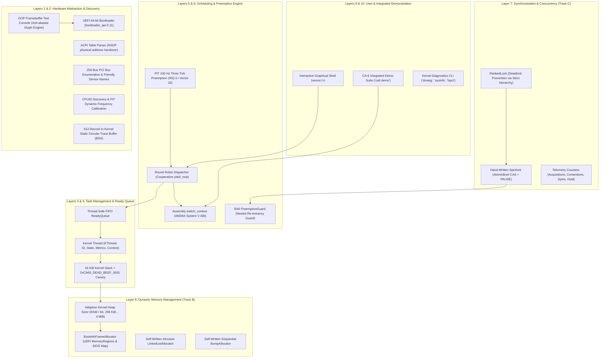
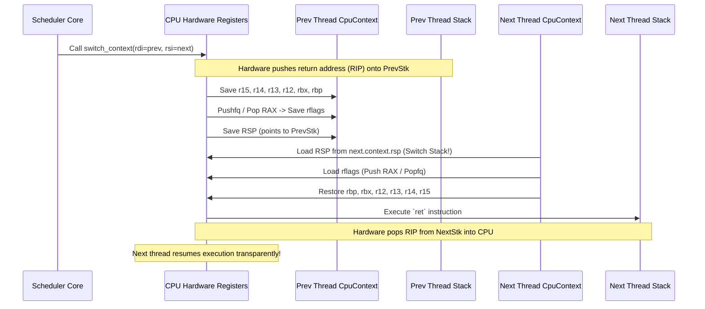

# VenOS — System Architecture & Design Specification

## Overview
**VenOS** is a production-grade 64-bit operating system kernel developed in safe systems Rust for x86_64 processors. Designed for both real bare-metal hardware (verified on HP Pavilion 15 laptop with 13th Gen Intel Core i5-1335U) and virtualized environments (QEMU/OVMF), VenOS implements a clean, layered monolithic architecture with explicit separation of concerns across 10 functional layers.

---

## 1. High-Level Architectural Diagram



---

## 2. Kernel Memory Layout

```
+------------------------------------+ 0xFFFF_FFFF_FFFF_FFFF  (Top of Virtual Address Space)
|          Kernel Space              |
|                                    |
|  Recursive Page Tables / Paging    |
|                                    |
|  Kernel Heap (Dynamically Sized)   |
|  [0x4444_4444_0000 .. +1720 KiB]   | <-- Adaptive Heap (1/64th RAM clamped 256K..4M)
|                                    |
|  Physical Memory Direct Mapping    |
|  [0x0000_8000_0000 .. Framebuffer] | <-- UEFI GOP Linear Framebuffer (1280x800 / 1920x1200)
|                                    |
+------------------------------------+ 0x0000_0000_0020_0000
|  Kernel Code, Data & BSS           |
|  - .text: Executable instructions  |
|  - .rodata: Constants, font glyphs |
|  - .bss: 512-record TraceRingBuffer| <-- Statically allocated, zero heap dependency
+------------------------------------+ 0x0000_0000_0000_0000  (Bottom of Address Space)
```

---

## 3. Task Lifecycle State Machine

```mermaid
stateDiagram-v2
    [*] --> Ready: KThread::new() / spawn()
    Ready --> Running: Scheduler Dispatch (dequeue)
    Running --> Ready: Voluntary yield_now() OR Timer Preemption (Quantum Expire)
    Running --> Blocked: Lock Acquisition Wait (Spinlock / Contention)
    Blocked --> Ready: Lock Released / Event Triggered
    Running --> Terminated: Thread Returns (thread_exit_trampoline)
    Terminated --> [*]: Memory Reaped by reap_terminated()
    
    note right of Running
        Canary Checked:
        0xCA60_DEAD_BEEF_0001
        Verified before context switch
    end note
```

---

## 4. AMD64 Assembly Context Switch Protocol

When transferring execution from `prev` thread to `next` thread via `switch_context(prev, next)`:



---

## 5. Track C Concurrency & Deadlock Prevention

### Mathematical Lock Ranking Model
Let $\mathcal{L} = \{L_1, L_2, \dots, L_k\}$ be the set of synchronization objects in the operating system. Each lock is assigned a unique, immutable monotonic integer rank:
$$\text{Rank}: \mathcal{L} \to \mathbb{N}^+$$

A thread $T$ holding a set of active locks with maximum currently held rank:
$$R_{\text{held}} = \max(\{0\} \cup \{\text{Rank}(L) \mid L \in \text{HeldBy}(T)\})$$
is legally permitted to request lock $L_{\text{req}}$ if and only if:
$$\text{Rank}(L_{\text{req}}) > R_{\text{held}}$$

```
                       [ Rank 30: User Data Lock ]
                                    ▲
                                    │  Legal: Ascending Acquisition (Strict Order)
                       [ Rank 20: VFS Inode Lock ]
                                    ▲
                                    │
                       [ Rank 10: Device Driver Lock ]
                                    ▲
                                    │
                       [ Rank 0:  Unheld Baseline ]
```

### Coffman Condition Elimination
- **Condition 1 (Mutual Exclusion):** Preserved for data integrity via `Spinlock<T>`.
- **Condition 2 (Hold and Wait):** Allowed.
- **Condition 3 (No Preemption):** Preserved for lock safety.
- **Condition 4 (Circular Wait):** **MATHEMATICALLY ELIMINATED.**
  - *Proof:* Suppose a circular wait chain exists: $T_1$ holds $L_1$ and waits for $L_2$; $T_2$ holds $L_2$ and waits for $L_3$; $\dots$; $T_n$ holds $L_n$ and waits for $L_1$. Under our acquisition protocol, this requires:
    $$\text{Rank}(L_1) < \text{Rank}(L_2) < \dots < \text{Rank}(L_n) < \text{Rank}(L_1)$$
    $$\implies \text{Rank}(L_1) < \text{Rank}(L_1)$$
    which is an immediate contradiction ($x \not< x$). Therefore, circular wait cannot exist, and deadlocks are impossible.

---

## 6. Device Abstraction & Hardware Driver Matrix

| Subsystem | Hardware Interface | Bare-Metal Target (HP Pavilion) | QEMU / Virtual Machine | Source Implementation |
|---|---|---|---|---|
| **Display** | UEFI GOP Framebuffer | 1920x1200 16:10 Intel Iris Xe | 1280x800 16:10 QEMU Cirrus/StdVGA | `src/framebuffer.rs` |
| **Timer** | Intel 8253/8254 PIT Ch 0 & 2 | 100 Hz IRQ 0 + Dynamic TSC Calibrator | 100 Hz IRQ 0 + Dynamic TSC Calibrator | `src/interrupts.rs` |
| **Keyboard** | Intel 8042 PS/2 Controller | EC PS/2 Emulation (`ACPI\HPQ8001`) | Standard i8042 PS/2 Controller | `src/interrupts.rs` |
| **Storage** | NVMe PCIe / ATA PIO | WD SN5000S NVMe SSD (PCIe Gen4) | ATA IDE Block Drive + RAM Disk | `src/storage/` |
| **ACPI** | UEFI RSDP Pointer | Physical RSDP Table Handover | OVMF / Bochs RSDP Handover | `src/acpi.rs` |
| **Ethernet** | Intel 82540EM (e1000) | Not Present on Motherboard | Emulated Gigabit NIC + smoltcp | `src/net/e1000.rs` |
| **Wireless** | MediaTek MT7921 Wi-Fi 6 | Discovered on PCIe, Software Emulation | Bridged Software Emulation | `src/net/wifi.rs` |
