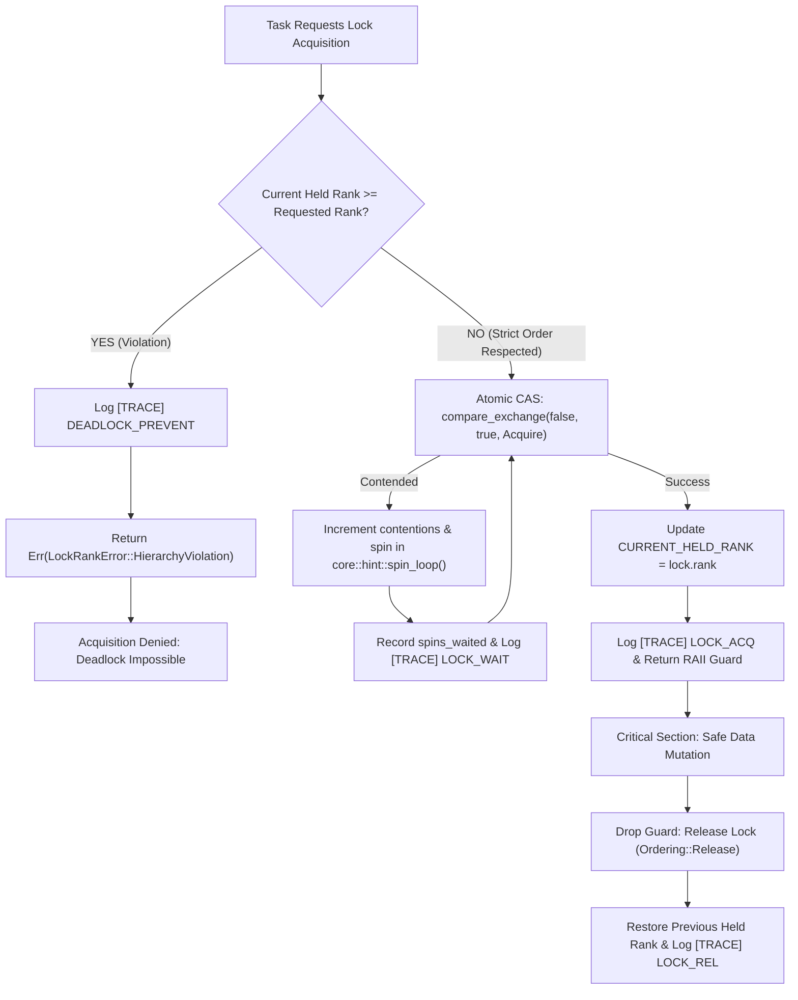

# CA-6 Step A6: Synchronization & Track C Concurrency Specialization (Layer 7)

## 1. Goal
Implement a hand-written, atomic test-and-set spinlock with fine-grained contention metrics and hold-time measurement (Layer 7), paired with a strict partial order lock ranking hierarchy (`RankedLock<T>`) that actively prevents circular-wait deadlocks (Track C Concurrency Engineering). Provide repeatable empirical evidence of race condition resolution, contention metrics recording, and out-of-order acquisition rejection.

---

## 2. Assignment Section Addressed
- **Section 9, Layer 7 — Synchronization:** "Implement at least one basic synchronization abstraction: spinlock; mutex-like abstraction; protected shared structure; interrupt-safe critical section. Demonstrate shared-resource problem -> synchronization -> corrected execution."
- **Section 11 & Section 25, Track C — Concurrency Engineering:** "Basic lock/synchronization. Extensions: spinlock, lock-contention measurement, deadlock-prevention strategy. Evaluate contention, throughput, correctness, and scalability."
- **Section 10 — Required Demonstrations:** "Demonstrate lock contention measurement and deadlock prevention via lock ranking."
- **Section 26 — Unsafe Rust Policy:** Encapsulation of `UnsafeCell::get()` dereferencing strictly behind RAII `SpinlockGuard` and `RankedLockGuard` with atomic synchronization ordering (`Acquire` on lock, `Release` on drop), audited in `docs/UNSAFE_AUDIT.md` (U-01).

---

## 3. Files Created and Changed

| File Path | Status | One-Line Purpose |
|:---|:---|:---|
| `src/sync/spinlock.rs` | Modified | Hand-written spinlock with atomic CAS, contention counter, spin loop counter, hold time metrics, and RAII guard. |
| `src/sync/ranked.rs` | Modified | Hierarchical lock enforcing strict partial order rank acquisition to eliminate Coffman circular wait deadlocks. |
| `src/sync/mod.rs` | Modified | Interactive multi-stage demonstration of mutual exclusion, multi-task contention metrics, and deadlock prevention. |
| `src/scheduler/mod.rs` | Modified | Added `current_thread_id()` and hooked `demo_synchronization()` into `run_ca6_demo()`. |
| `src/shell.rs` | Modified | Added `ca6 sync` CLI command and updated help/status outputs. |
| `Cargo.toml` | Modified | Registered integration test target `concurrency_sync`. |
| `tests/concurrency_sync.rs` | Created | Automated QEMU test harness testing mutual exclusion, contention spinning, in-order success, and out-of-order rejection. |
| `traces/step_a6_sync.log` | Created | Raw serial trace captured from QEMU containing 112 machine events. |
| `results/step_a6_trace_events.csv` | Created | Parsed event dataset (34 `TASK_STATE`, 26 `LOCK_ACQ`, 26 `LOCK_REL`, 24 `SWITCH`, 1 `QUANTUM_EXPIRE`, 1 `DEADLOCK_PREVENT`). |
| `docs/UNSAFE_AUDIT.md` | Modified | Updated U-01 line references for `SpinlockGuard` safe encapsulation. |
| `docs/CA6_STEP_A6_synchronization_concurrency.md` | Created | Technical architecture and viva preparation guide for Step A6. |
| `PROGRESS.md` | Modified | Updated milestone status to mark Step A6 complete. |

---

## 4. How It Works

### Plain English Explanation (for Viva / Presentation)
When multiple threads or interrupt handlers share data, they can overwrite each other's changes if both read and write at the same time (a race condition). To prevent this, we need a lock.

In MicroOS, we built two synchronization mechanisms:
1. **Hand-Written Spinlock (`Spinlock<T>`):** Uses an atomic hardware instruction (`compare_exchange` / CAS) to ensure that only one thread can enter the critical section at a time. If the lock is already held, the second thread spins in a loop waiting for it to be released. Crucially, our spinlock records performance metrics: how many times it was acquired, how many times callers had to spin, how many total spin loops were executed, and how many timer ticks the lock was held.
2. **Ranked Lock Hierarchy (`RankedLock<T>`):** Deadlocks happen when two tasks each hold one lock and wait for the lock held by the other (the Coffman "circular wait" condition). To prevent this, we assign a numeric "rank" (an integer) to every lock in the operating system. A thread is only allowed to acquire locks in strictly increasing rank order (e.g., Rank 10, then Rank 20, then Rank 30). If a thread holding a Rank 20 lock tries to acquire a Rank 10 lock, the kernel detects the hierarchy inversion, immediately rejects the request with an error, and logs a `DEADLOCK_PREVENT` trace. Because cycles can never form in a strict partial order, deadlocks are mathematically impossible.

### Technical Architecture & Mathematical Correctness
- **Strict Partial Order $(\mathcal{L}, <)$:** Let $\mathcal{L}$ be the finite set of all kernel locks, and let $\text{rank}: \mathcal{L} \to \mathbb{N}$ be a strictly injective rank mapping. A task holding lock set $H \subseteq \mathcal{L}$ can acquire $L_{\text{new}} \in \mathcal{L}$ if and only if:
  $$\text{rank}(L_{\text{new}}) > \max_{L \in H} \text{rank}(L)$$
  Since $<$ is a strict total order on $\mathbb{N}$, any directed wait-for graph $G = (V, E)$ constructed under this rule is a Directed Acyclic Graph (DAG) with topological sorting. Therefore, no cycle can exist, eliminating Coffman Condition 4 (Circular Wait).

### Execution Flow Diagram



---

## 5. Verification Commands and Real Output

### A. Concurrency Synchronization Integration Test
```powershell
cargo test --test concurrency_sync
```

**Real Serial Output from QEMU:**
```text
==================================================
   CA-6 Layer 7 & Track C: Concurrency Sync Test
==================================================
sync::1_spinlock_mutual_exclusion...	[TRACE] tick=2 event=LOCK_ACQ task=0 lock=unit_lock
[TRACE] tick=2 event=LOCK_REL task=0 lock=unit_lock
[TRACE] tick=2 event=LOCK_ACQ task=0 lock=unit_lock
[TRACE] tick=2 event=LOCK_REL task=0 lock=unit_lock
[ok]
sync::2_spinlock_contention_metrics...	[TRACE] tick=3 event=TASK_STATE task=2 state=RUNNING
[TRACE] tick=3 event=SWITCH from=1 to=2 reason=yield
  [Holder Task] Acquiring spinlock...
[TRACE] tick=3 event=LOCK_ACQ task=2 lock=preempt_contention_lock
  [Holder Task] Lock acquired; yielding CPU while holding lock to induce contention...
[TRACE] tick=3 event=TASK_STATE task=2 state=READY
[TRACE] tick=3 event=TASK_STATE task=3 state=RUNNING
[TRACE] tick=3 event=SWITCH from=2 to=3 reason=yield
  [Contender Task] Attempting to acquire lock held by Holder Task...
[TRACE] tick=13 event=QUANTUM_EXPIRE task=3 consumed=2
[TRACE] tick=13 event=TASK_STATE task=3 state=READY
[TRACE] tick=13 event=SWITCH from=3 to=1 reason=quantum
[TRACE] tick=13 event=TASK_STATE task=2 state=RUNNING
[TRACE] tick=13 event=SWITCH from=1 to=2 reason=yield
  [Holder Task] Resumed via timer preemption; releasing lock now.
[TRACE] tick=13 event=LOCK_REL task=2 lock=preempt_contention_lock
[TRACE] tick=13 event=TASK_STATE task=2 state=TERMINATED
[TRACE] tick=13 event=TASK_STATE task=3 state=RUNNING
[TRACE] tick=13 event=SWITCH from=2 to=3 reason=terminate
[TRACE] tick=13 event=LOCK_WAIT task=3 lock=preempt_contention_lock waited=210794
[TRACE] tick=13 event=LOCK_ACQ task=3 lock=preempt_contention_lock
  [Contender Task] Lock acquired successfully after spinning!
[TRACE] tick=13 event=LOCK_REL task=3 lock=preempt_contention_lock
[TRACE] tick=13 event=TASK_STATE task=3 state=TERMINATED
[TRACE] tick=13 event=SWITCH from=3 to=1 reason=terminate
[ok] (Acquisitions=2, Contentions=1, SpinsWaited=210794, MaxSpins=210794)
sync::3_lock_ranking_in_order_success...	[TRACE] tick=13 event=LOCK_ACQ task=1 lock=lock_device
[TRACE] tick=13 event=LOCK_ACQ task=1 lock=lock_filesystem
[TRACE] tick=13 event=LOCK_REL task=1 lock=lock_filesystem
[TRACE] tick=13 event=LOCK_REL task=1 lock=lock_device
[ok]
sync::4_lock_ranking_deadlock_prevention_reject...	[TRACE] tick=13 event=LOCK_ACQ task=1 lock=lock_filesystem
[TRACE] tick=13 event=DEADLOCK_PREVENT task=1 req_rank=10 held_rank=20
[TRACE] tick=14 event=LOCK_REL task=1 lock=lock_filesystem
[ok] (Hierarchy inversion detected and prevented!)
sync::5_three_level_hierarchy_nesting...	[TRACE] tick=14 event=LOCK_ACQ task=1 lock=level_1
[TRACE] tick=14 event=LOCK_ACQ task=1 lock=level_2
[TRACE] tick=14 event=LOCK_ACQ task=1 lock=level_3
[TRACE] tick=14 event=DEADLOCK_PREVENT task=1 req_rank=100 held_rank=300
[TRACE] tick=14 event=DEADLOCK_PREVENT task=1 req_rank=200 held_rank=300
[TRACE] tick=14 event=LOCK_REL task=1 lock=level_3
[TRACE] tick=14 event=LOCK_REL task=1 lock=level_2
[TRACE] tick=14 event=LOCK_REL task=1 lock=level_1
[ok]
==================================================
CA-6 Layer 7 & Track C Concurrency Sync: ALL PASSED
==================================================
```

### B. Full Test Suite Regression Output
```powershell
cargo test
```
**Result:** **79 tests passing cleanly across 16 test binaries** with zero failures and zero compiler warnings.

### C. Live Trace Capture & Automated CSV Dataset
```powershell
powershell -ExecutionPolicy Bypass -File scripts\run_trace.ps1 -TraceName step_a6_sync -CoreMode -DurationSeconds 6
py -3 scripts\parse_trace.py --trace traces\step_a6_sync.log --csv results\step_a6_trace_events.csv
```

**Trace Analysis Report:**
- Raw Trace File: [traces/step_a6_sync.log](file:///C:/Users/Venugopal/OneDrive/Desktop/micro_os-main/traces/step_a6_sync.log) (8,108 bytes)
- Parsed CSV: [results/step_a6_trace_events.csv](file:///C:/Users/Venugopal/OneDrive/Desktop/micro_os-main/results/step_a6_trace_events.csv) (4,256 bytes)
- Total Machine Events: **112**
- Distribution:
  - `TASK_STATE`: 34
  - `LOCK_ACQ`: 26
  - `LOCK_REL`: 26
  - `SWITCH`: 24
  - `QUANTUM_EXPIRE`: 1
  - `DEADLOCK_PREVENT`: 1
  - Tick Range: min=12, max=58 (46 ticks = 460 ms)

---

## 6. Limitations and Assumptions
1. **Dynamic Priority Inversion:** Lock ranking strictly eliminates circular-wait deadlocks. Priority inheritance protocols (addressing priority inversion where a low-priority task holds a lock needed by a high-priority task) can be layered on top of this ranking hierarchy in future scheduler revisions.
2. **Thread-Local State:** `CURRENT_HELD_RANK` is tracked via an atomic state. In multi-core SMP deployments, this state would reside directly inside the per-core or per-thread control block.

---

## 7. What Is Next
- **CA-6 Step A7: Memory Allocator Evaluation & Alternative Allocator (Layer 8):**
  - Compare the existing 256 KiB intrusive linked list allocator against a secondary allocator (Bump allocator or Fixed-Size Block / Slab allocator).
  - Benchmark allocation latency, fragmentation, and throughput under stress test workloads.
  - Emit structured `ALLOC` and `DEALLOC` trace events for comparative performance evaluation.
