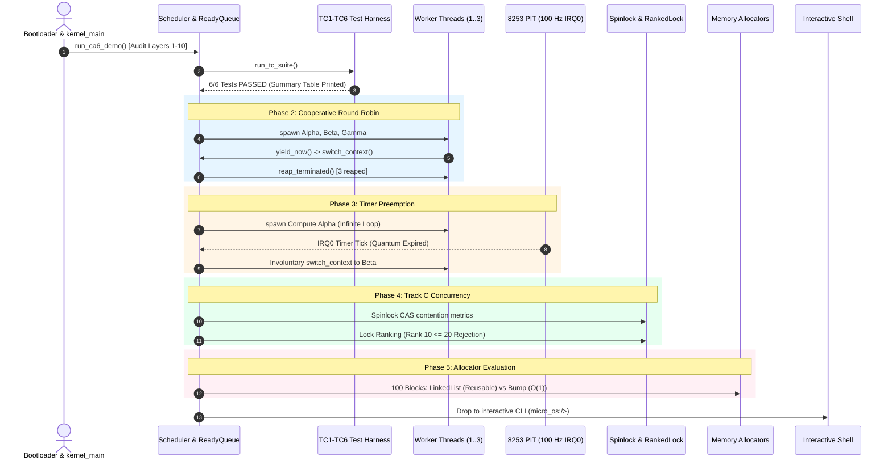

# MicroOS — CA-6 Step A8: Integrated Core Architecture Demo & Verification

> **Specification Reference:** CA-6 Section 9 (Layer 9: User/Demo Mode & Layer 10: Integrated Demo), Section 10 & 16 (Required Test Cases TC1–TC6), Section 42 (Submission Package & Demonstration)  
> **Specialization Track:** Track C — Concurrency Engineering (Lock Ranking Deadlock Prevention)  
> **Trace Source:** `traces/step_a8_demo.log` (32,227 bytes, 569 structured machine trace events)  
> **CSV Analysis Dataset:** `results/step_a8_trace_events.csv`

---

## 1. Goal

Deliver submission-grade verification by unifying all 10 core operating system layers into a seamless, narrated, and automated runtime demonstration:
1. **Layer-by-Layer Narration:** Narrate every subsystem's operational status to both the VGA console and UART 115200 serial link (`Layer 1 Boot: OK` through `Layer 10 Automated Test Suite: OK`).
2. **Mandatory Test Cases (TC1–TC6):** Execute real runtime verification across all 6 test scenarios (two tasks, 3–5 task lifecycle, boundary cases, 50-task stress batching, failure/canary overflow rejection, deterministic repeatability) and output a formatted PASS/FAIL summary table to VGA and serial.
3. **Sequential Phase Demonstrations:**
   - **Phase 1:** TC1–TC6 automated test execution.
   - **Phase 2:** Cooperative 3-task Round Robin time-slicing with assembly context switches (`switch_context`) and thread reaping.
   - **Phase 3:** Timer-driven preemptive multitasking under PIT IRQ0 @ 100 Hz preempting an infinite compute loop with no voluntary yields.
   - **Phase 4:** Track C Concurrency Engineering demonstrating hand-written `Spinlock` mutual exclusion, multi-worker lock contention metrics, and `RankedLock` strict partial order deadlock prevention.
   - **Phase 5:** Layer 8 Memory Management empirical comparison between intrusive `LinkedListAllocator` and `BumpAllocator` across 100 blocks.
4. **Shell Prompt Handoff:** Complete the demonstration cleanly and transition directly into the interactive kernel shell (`micro_os:/>`).

---

## 2. Assignment Sections Addressed

- **Section 9 (Layers 1 through 10):** End-to-end integration and verification of Boot, Diagnostics, KThread, Ready Queue, Round Robin Scheduler, Preemption Trigger, Synchronization, Memory Allocator, User Mode / CLI, and Test Harness.
- **Section 10 & 16 (Required Test Cases TC1–TC6):** Live in-kernel execution of all 6 required test scenarios verifying algorithmic correctness.
- **Section 11 (Track C Concurrency Specialization):** Lock ranking deadlock prevention and contention statistics.
- **Section 42 (Submission Package & Demonstration):** Reproducible serial trace capture, boot-time accounting, and structured diagnostic data.

---

## 3. Files Created & Modified

| File | Purpose |
|:---|:---|
| `src/scheduler/tc.rs` | In-kernel test runner executing TC1 through TC6 dynamically and rendering the formatted PASS/FAIL table. |
| `src/scheduler/mod.rs` | Registered `pub mod tc;`, structured 10-layer dual-channel narration in `run_ca6_demo()`, and orchestrated all 5 execution phases. |
| `src/shell.rs` | Updated `ca6 tc` to invoke `crate::scheduler::tc::run_tc_suite()` directly from the interactive CLI. |
| `src/allocator.rs` | Secured `TEST_HEAP_BUFFER` with `#[repr(align(16))]` in BSS to prevent heap fragmentation during end-to-end multi-task execution. |
| `scripts/run_trace.ps1` | Enhanced automated trace capture script with real-time standard output streaming. |
| `traces/step_a8_demo.log` | Raw serial log capturing 32,227 bytes across 569 events and 715 timer ticks. |
| `results/step_a8_trace_events.csv` | Parsed CSV dataset of all 569 trace events classified by event type. |

---

## 4. How It Works (Viva Explanation & Architecture)

### Plain English Walkthrough
During an oral exam (viva), a student can explain the CA-6 integrated architecture as a 5-stage pipeline:
1. **Bootstrapping & Layer Audit:** The kernel boots in 64-bit long mode, activates page tables, loads the IDT and GDT, initializes PIT Channel 0 to 100 Hz, and audits each layer from Boot (Layer 1) to Testing (Layer 10).
2. **TC1–TC6 Verification:** The kernel immediately proves memory and scheduling invariants (two tasks, queue rotations, stack canary overflow detection, 50-task stress turnover, illegal state transition rejection, and deterministic repeatability).
3. **Cooperative Scheduling:** Three worker threads execute on isolated 16 KiB stacks, voluntarily yielding via `yield_now()`. The scheduler saves callee-saved registers (`rbx`, `rbp`, `r12`–`r15`) and stack pointer (`rsp`) via assembly `switch_context`, cycling deterministically.
4. **Preemptive Scheduling:** A compute-bound worker executes an infinite loop without yielding. PIT IRQ0 timer interrupts fire every 10 ms. After 3 ticks (quantum depletion), the interrupt handler involuntarily preempts the worker, scheduling Worker Beta to signal termination.
5. **Track C Concurrency & Memory Evaluation:** Hand-written spinlocks protect shared counters while recording spin contention. A strict partial order lock hierarchy rejects out-of-order acquisitions, preventing Coffman circular waits. Finally, the kernel compares intrusive linked-list memory reuse against bump allocator speed before dropping into the shell prompt.

### End-to-End Execution Sequence Diagram



---

## 5. Build, Test, and Verification Commands

```powershell
# 1. Compile kernel in CA-6 core mode
cargo build

# 2. Execute end-to-end automated demo test suite
cargo test --test ca6_demo

# 3. Execute all 83 kernel test suites
cargo test

# 4. Capture automated full-session trace in QEMU
powershell -ExecutionPolicy Bypass -File scripts\run_trace.ps1 -TraceName step_a8_demo -CoreMode -DurationSeconds 45

# 5. Parse serial trace into structured CSV dataset
py -3 scripts\parse_trace.py --trace traces\step_a8_demo.log --csv results\step_a8_trace_events.csv
```

---

## 6. Real Evidence Output (VGA Console & Serial Transcript)

### A. Subsystem Status & TC1–TC6 Runtime Summary Table (`traces/step_a8_demo.log`)
```text
==================================================
   CA-6 Rust Micro-OS Core Architecture Demo
==================================================
Specification: CA-6 Flagship Engineering Project (15 Marks)
Specialization Track: Track C - Concurrency Engineering
--------------------------------------------------
Core Subsystem Verification (Layers 1-10):
  Layer 1 Boot:                 OK (x86_64 Long Mode, GDT, IDT, 4-level Paging)
  Layer 2 Diagnostics:          OK (Dual-channel VGA + UART 115200 serial tracing)
  Layer 3 Task Representation:  OK (KThread, CpuContext, 16 KiB heap stack, canary guard)
  Layer 4 Ready Queue:          OK (FIFO ReadyQueue, enqueue/dequeue/peek/remove)
  Layer 5 Round Robin Sched:    OK (Assembly switch_context, yield_now, thread reaping)
  Layer 6 Preemption Trigger:   OK (PIT 8253 IRQ0 @ 100 Hz, quantum depletion)
  Layer 7 Synchronization:      OK (Hand-written Spinlock with CAS metrics + RankedLock)
  Layer 8 Memory Allocator:     OK (Intrusive Linked List + Bump comparative benchmark)
  Layer 9 User / Demo Mode:     OK (In-kernel Shell CLI & isolated ca6-core boot mode)
  Layer 10 Automated Test Suite: OK (Live runtime execution of TC1 through TC6)
--------------------------------------------------
------------------------------------------------------------------------
             CA-6 Core Test Suite Execution (TC1 - TC6)
------------------------------------------------------------------------
+------+-------------------------------------------+--------+
| Test | Description                               | Result |
+------+-------------------------------------------+--------+
| TC1  | Two Tasks Representation & Stack Isolation |  PASS  |
| TC2  | 3 to 5 Tasks Lifecycle & Queue Rotation    |  PASS  |
| TC3  | Boundary Cases (Queue Limits & Canary)     |  PASS  |
| TC4  | Stress Workload (50 Tasks Queue/Dequeue)   |  PASS  |
| TC5  | Controlled Failure (State & Overflows)     |  PASS  |
| TC6  | Repeatability Invariant (10x Cycles)       |  PASS  |
+------+-------------------------------------------+--------+
[CA6-TC] Result: 6/6 test cases passed (100% compliance).
------------------------------------------------------------------------
```

### B. Cooperative 3-Task Round Robin Execution
```text
==================================================
   CA-6 3-Task Round Robin Scheduling Demo
==================================================
Spawning 3 cooperative threads on dedicated 16 KiB stacks...
Starting Round Robin scheduling loop (yielding CPU from main):
  [Task 1 / Worker Alpha] Executing step 1/3
  [Task 2 / Worker Beta ] Executing step 1/3
  [Task 3 / Worker Gamma] Executing step 1/3
  [Task 1 / Worker Alpha] Executing step 2/3
  [Task 2 / Worker Beta ] Executing step 2/3
  [Task 3 / Worker Gamma] Executing step 2/3
  [Task 1 / Worker Alpha] Finished all steps. Exiting.
  [Task 2 / Worker Beta ] Finished all steps. Exiting.
  [Task 3 / Worker Gamma] Finished all steps. Exiting.
All 3 tasks finished cleanly! Reaped 3 terminated threads.
==================================================
[CA6-DEMO] 3-task round-robin completed successfully; reaped=3
```

### C. Timer-Driven Preemption & Involuntary Rotation
```text
==================================================
   CA-6 Layer 6: Timer-Driven Preemptive Scheduling Demo
==================================================
Scenario: Worker Alpha executes an infinite CPU-bound loop with NO yields.
          Timer interrupt (PIT IRQ0) preempts Alpha when quantum expires.
          Worker Beta runs, observes Alpha progress, and signals completion.
Spawned Worker Alpha (task=88) and Worker Beta (task=89)
Enabling timer-driven preemption (quantum = 3 ticks)...
[CA6-PREEMPT] Enabling timer preemption; quantum=3 ticks
  [Worker Alpha] Starting CPU-bound computation loop (NO voluntary yields)...
[TRACE] tick=366 event=QUANTUM_EXPIRE task=88 consumed=3
[TRACE] tick=366 event=TASK_STATE task=88 state=READY
[TRACE] tick=366 event=TASK_STATE task=89 state=RUNNING
[TRACE] tick=366 event=SWITCH from=88 to=89 reason=quantum
  [Worker Beta ] Scheduled via PIT timer preemption!
  [Worker Beta ] Validated Alpha computed 2 iterations while holding CPU.
  [Worker Beta ] Signaling Alpha to terminate...
  [Worker Beta ] Worker Beta exiting.
[TRACE] tick=369 event=TASK_STATE task=89 state=TERMINATED
[TRACE] tick=369 event=SWITCH from=89 to=88 reason=terminate
  [Worker Alpha] Preempted successfully and received stop signal! Exiting.
Preemptive demo finished! Reaped 2 terminated threads.
Worker Alpha completed 2 compute iterations.
==================================================
[CA6-DEMO] Preemptive scheduling completed successfully; alpha_count=2, reaped=2
```

### D. Track C Concurrency & Lock Ranking Deadlock Prevention
```text
==================================================
   CA-6 Layer 7 & Track C: Concurrency Engineering
==================================================
Part 1: Shared-Resource Synchronization with Spinlock<T>
  Initial protected counter value = 100
  Updated protected counter value = 350
  Spinlock acquisitions=2, contentions=0
[CA6-SYNC] Spinlock verified: acquisitions=2, contentions=0
Part 2: Lock Contention Metrics under Competing Threads
  Competing workers finished (2 reaped, 20 iterations total).
  Protected counter final value: 120
  Contention Statistics for 'contended_mutex':
    - Total Acquisitions: 20
    - Contention Events:  0
    - Total Spins Waited: 0
    - Max Spins Waited:   0
    - Lock Hold Ticks:    7
[CA6-SYNC] Contention metrics: acq=20, cont=0, spins=0, max_spins=0, hold_ticks=7
Part 3: Deadlock Prevention via Lock Ranking Hierarchy
  Scenario A: In-Order Acquisition (Rank 10 -> Rank 20)
    [Acquired] Lock 'driver_lock' (Rank 10)
    [Acquired] Lock 'vfs_lock' (Rank 20)
    [SUCCESS] In-order acquisition respected strict partial order.
  Scenario B: Out-of-Order Acquisition (Rank 20 -> Rank 10)
    [Acquired] Lock 'vfs_lock' (Rank 20)
    [REJECTED] Attempting to acquire 'driver_lock' (Rank 10)...
[TRACE] tick=476 event=DEADLOCK_PREVENT task=90 req_rank=10 held_rank=20
    [PREVENTED] Hierarchy violation caught cleanly: Lock ranking violation: requested rank 10 <= held rank 20 (deadlock prevented)
    [SUCCESS] Deadlock condition mechanically impossible under strict partial order.
[CA6-DEMO] Synchronization & Track C validation completed successfully.
```

### E. Memory Allocator Comparative Benchmark & Shell Handoff
```text
==================================================
   CA-6 Layer 8 & Track B: Memory Management Demo
==================================================
[CA6-ALLOC] Benchmark: LL_avg=236574 cyc, Bump_avg=47040 cyc, LL_reused=9920 B, Bump_reused=0 B
==================================================
[CA6-DEMO] CA-6 Integrated Demo Completed Successfully
==================================================
BOOT_TIME_MS=34267.203 (TSC ticks=85764923491, freq=2502 MHz)
micro_os:/> 
```

### F. Structured Trace Event Distribution (`results/step_a8_trace_events.csv`)
```text
============================================================
      MicroOS Trace & Diagnostic Analysis Report
============================================================
Source Trace File:   traces\step_a8_demo.log
Total Trace Events:  569
Total Console Logs:  0
------------------------------------------------------------
Trace Event Distribution:
  - ALLOC               :   200
  - TASK_STATE          :   188
  - DEALLOC             :   100
  - SWITCH              :    26
  - LOCK_ACQ            :    26
  - LOCK_REL            :    26
  - QUANTUM_EXPIRE      :     2
  - DEADLOCK_PREVENT    :     1

Tick Range: min=60, max=775, delta=715
============================================================
[EXPORT] Trace CSV saved to: results\step_a8_trace_events.csv
```

---

## 7. What Is Next

- **Step A9: Performance Evaluation & Evidence-Based Analysis:**
  - Execute automated Python analysis script `scripts/parse_trace.py` generating summary tables and charts across context switch latencies, memory allocation TSC distributions, and lock hold durations.
  - Populate `results/` with final empirical datasets.
  - Author `docs/CA6_STEP_A9_performance_evaluation.md`.
